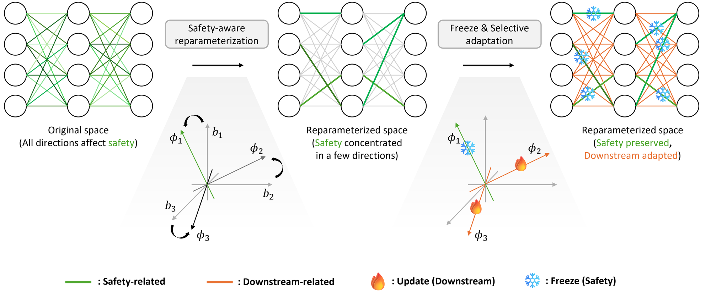

<div align="center">

# Rethinking LLM Fine-Tuning via Weight Space Reparameterization: Preserving Safety during Downstream Adaptation


[**Paper (arXiv)**](#) | [**OpenReview**](#)

[Min-Seong Kim](#)\*, [Jongbok Won](#)\*, [Jeesup Park](#), [Yonghee Choi](#), [Dong-Jun Han](#)

Yonsei University


</div>

<p align="center"></p>

**WSR-Tune (Weight Space Reparameterization Tuning) preserves the safety of an aligned LLM while it is fine-tuned on a downstream task.** Fine-tuning in the original parameter space erodes refusal behavior because safety-related information is spread across many weight directions, so even partial updates overwrite it. WSR-Tune instead *reparameterizes* each weight matrix into a **safety-conditioned basis** built from the activations of a safety calibration set, where safety-relevant information concentrates in a small subset of coefficients. The safety-critical coefficients are identified by their safety-loss gradients and **frozen**, while the complementary coefficients are updated for the downstream task. This disentangles safety preservation from task adaptation and yields a markedly better safety-downstream trade-off than full fine-tuning and prior safety-preserving baselines on Llama, Qwen, and Gemma models across GSM8K, MATH, ARC-Challenge, and MedQA.

## Overview

This repository is the official implementation. The pipeline has three phases:

| Phase | Script | What it does | Output |
| --- | --- | --- | --- |
| 1. Basis construction | `scripts/phase1_basis.sh` | Input-activation Gram matrices on the calibration set, SVD per projection | `phase1/basis/` |
| 2. Importance and masks | `scripts/phase2_mask.sh` | Absolute safety-loss gradients on the reparameterized coefficients, top-ρ masks per matrix | `phase2/importance/`, `phase2/masks/` |
| 3. Downstream fine-tuning | `scripts/phase3_finetune.sh` | Masked fine-tuning on GSM8K, MATH, ARC-Challenge, or MedQA; export a standard checkpoint | `phase3_<task>/final_model/` |

## Installation

```bash
conda create -n wsr-tune python=3.10 -y
conda activate wsr-tune
python -m pip install -r requirements.txt
```


## Models and data

**Starting model.** WSR-Tune is applied to a *safety-aligned* model $w_0$. 

**Safety calibration set (Phases 1 and 2).** `data/safety_calibration.json`
contains the 4,994 Circuit Breakers prompts paired with safe refusals. See
[`data/README.md`](data/README.md) for provenance and license.

**Downstream tasks (Phase 3).** Training splits are downloaded from Hugging Face
Datasets on first use:

| `TASK` | Dataset | 
| --- | --- | 
| `gsm8k` | `openai/gsm8k` (`main`, train) | 
| `math` | `EleutherAI/hendrycks_math` (7 subjects, train) |
| `arc_challenge` | `allenai/ai2_arc` (`ARC-Challenge`, train) |
| `medqa` | `openlifescienceai/medqa` (USMLE, train) |

With a chat template the prompt is the user turn and the target is the assistant
turn; with `CHAT_FORMAT=plain` the task-specific plain prompt is used
(`Question: ...\nAnswer:` for GSM8K/MATH). Loss is computed on response tokens
only. A local copy can be supplied with `TASK_PATH` (see `data/README.md`).

## Run the full pipeline

Edit `scripts/common.sh` for shared settings such as the model, output root,
target projections, precision, sequence length, and seed. Calibration settings
are in `scripts/phase1_basis.sh` and `scripts/phase2_mask.sh`; choose the task
and training settings in `scripts/phase3_finetune.sh`.

Each script uses `${NAME:-value}` defaults, so edit the value after `:-` in
the file or override it with an environment variable. For example:

```bash
export CUDA_VISIBLE_DEVICES=0
export MODEL="meta-llama/Llama-2-7b-chat-hf"
export RUN_DIR="outputs/llama2_7b_chat"
bash scripts/run_all.sh
```

`run_all.sh` uses the task and training settings from `phase3_finetune.sh`.
Each phase writes to its own directory under `$RUN_DIR`; an existing nonempty
phase directory is rejected, so choose a new `RUN_DIR` for a new run.

## Run phases separately

```bash
# Phase 1: construct and save the basis.
bash scripts/phase1_basis.sh

# Phase 2: measure importance and save scores and protection masks.
bash scripts/phase2_mask.sh

# Phase 3: fine-tune with the protected coefficients frozen.
bash scripts/phase3_finetune.sh
```

All four downstream tasks use the same Phase 3 script. Edit its configuration
block to select a task and change the training arguments, for example:

```bash
# Settings inside scripts/phase3_finetune.sh
TASK="${TASK:-gsm8k}"             # gsm8k | math | arc_challenge | medqa
TASK_PATH="${TASK_PATH:-}"        # Optional local JSON/JSONL file
TASK_SAMPLES="${TASK_SAMPLES:-}"  # Empty: task default; 0: full split; N: sample N rows
EPOCHS="${EPOCHS:-3}"
LEARNING_RATE="${LEARNING_RATE:-5e-5}"
TRAIN_BATCH_SIZE="${TRAIN_BATCH_SIZE:-2}"
GRAD_ACCUM="${GRAD_ACCUM:-8}"
```

Environment overrides and extra training arguments also work for individual
phases. Select the task with `TASK` so the sample default and output directory
follow the same task:

```bash
TASK=medqa TRAIN_BATCH_SIZE=1 GRAD_ACCUM=16 \
  bash scripts/phase3_finetune.sh --learning_rate 1e-5
```

The basis and masks depend only on the model and the safety set, so each task
reuses the same `phase1/` and `phase2/` outputs. Keep the shared model,
precision, input format, and target projections consistent across phases:

```text
$RUN_DIR/
  phase1/basis/                 # complete input bases and metadata
  phase2/importance/            # absolute-gradient importance scores
  phase2/masks/                 # boolean protection masks and metadata
  phase3_<task>/final_model/    # standard Hugging Face model and tokenizer
  phase3_<task>/training_summary.json
```

For custom runs, call `python train.py --help`. For example:

```bash
python train.py --phase 3 --model "$MODEL" \
  --basis_dir "$RUN_DIR/phase1/basis" --masks_dir "$RUN_DIR/phase2/masks" \
  --task medqa --task_samples 10000 \
  --output_dir outputs/custom/phase3_medqa \
  --batch_size 1 --gradient_accumulation_steps 16 \
  --epochs 3 --learning_rate 5e-5 --gradient_checkpointing
```


## Citation

```bibtex
@inproceedings{wsrtune2026,
  title     = {Rethinking LLM Fine-Tuning via Weight Space Reparameterization:
               Preserving Safety during Downstream Adaptation},
  author    = {Kim, Min-Seong and Won, Jongbok and Park, Jeesup and Choi, Yonghee and Han, Dong-Jun},
  booktitle = {Advances in Neural Information Processing Systems (NeurIPS)},
  year      = {2026},
  note      = {Spotlight}
}
```

## License and acknowledgements

This code is released under the [MIT License](LICENSE). The calibration set is
derived from the Circuit Breakers training data (MIT License); downstream data
is downloaded from the datasets listed above under their own licenses. See
[`data/README.md`](data/README.md) for details.
